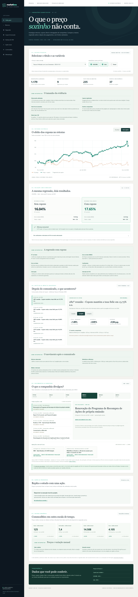

# Market Lens BR

Pesquisa quantitativa reproduzível sobre títulos públicos, fatores de mercado, commodities e divulgações de companhias brasileiras. A demonstração pública compara uma regressão de **retorno de preço** com a mesma regressão após incorporar **cupons por unidade**, usando exatamente as mesmas datas e variáveis. Uma pesquisa local permite repetir a comparação para ações com e sem dividendos e JCP.



## O que já funciona

- Catálogo de títulos do Tesouro, USD/BRL, Selic e Brent diários, com fonte, unidade, frequência, período e versão do retrato. Ouro, cobre, café arábica e Brent do Banco Mundial aparecem em uma seção mensal separada.
- Gráfico de retorno acumulado com e sem cupons; pagamentos no intervalo entre duas cotações são atribuídos ao retorno desse intervalo.
- Regressão OLS com coeficientes, intervalos de 95%, R², erro e validação temporal fora da amostra. O botão destaca cada modo sem trocar as datas ou os fatores.
- Guias visíveis explicam observações, índice base 100, R², coeficientes, RMSE, intervalos e diferenças em pontos percentuais; a interpretação acompanha o modo e a janela escolhidos.
- Comunicados oficiais do Copom ligados a janelas posteriores de 1, 3 e 5 pregões, comparados a outro título do Tesouro. A página mostra a fonte, o tamanho da amostra e a incerteza do conjunto de eventos.
- Fatos relevantes e comunicados de seis companhias no arquivo público da CVM, com links aos documentos originais e contexto de cobertura detectada pelo GDELT.
- Importação **somente local** de CSVs de preços, desdobramentos, dividendos e JCP. A regressão mantém as mesmas datas e fatores nos modos sem e com proventos. Cada fato relevante ou comunicado ao mercado elegível da CVM pode ser ligado ao retorno posterior da ação nos dois modos, diante de modelos ajustados apenas com sessões anteriores.
- CSV opcional de notícias com fonte e data verificadas pelo pesquisador. Cada notícia recebe janelas de 1, 3 e 5 pregões, retorno observado, referência de fatores, diferença em pontos percentuais e comparação com e sem proventos.
- Retratos públicos congelados de mercado e notícias em `backend/demo/`, com comandos separados para atualização.

O projeto é uma análise histórica exploratória. Diferenças após uma divulgação são associações temporais, não estimativas causais nem recomendações de investimento. A cobertura GDELT é contexto: sem data de publicação verificada, cada link permanece sem impacto quantitativo atribuído. O cálculo de ações usa divulgações oficiais da CVM ou referências jornalísticas verificadas pelo pesquisador, junto dos preços importados. O método completo está em [docs/METODOLOGIA.md](docs/METODOLOGIA.md).

## Executar localmente

Requisitos: Python 3.12+ e Node.js 20+.

```bash
python -m venv .venv
# Windows: .venv\Scripts\activate
# macOS/Linux: source .venv/bin/activate
pip install -e "backend[dev]"
cd backend
python -m app.data.demo
python -m app.data.demo --database data/company_news.db --archive demo/company_news_snapshot.sqlite.gz
uvicorn app.main:app --reload
```

Em outro terminal:

```bash
cd frontend
npm ci
npm run dev
```

Abra `http://localhost:5173`. O Vite encaminha `/api` ao backend local. Para atualizar o retrato com as fontes oficiais, rode na pasta `backend/`:

```bash
python -m app.data.refresh --database data/market_lens.db
```

Essa operação consulta Tesouro, BCB, EIA e Banco Mundial, valida os dados e substitui o banco local somente após concluir a nova versão. Para atualizar documentos e contexto de cobertura, execute `python -m app.data.news_store --database data/company_news.db`. A coleta opcional GDELT respeita o limite de consultas e pode ficar indisponível; referências recentes já armazenadas são preservadas por até 14 dias. Os bancos locais ficam fora do Git.

Para habilitar importação de ações em seu próprio computador, defina `LOCAL_IMPORT_ENABLED=true` no ambiente antes de iniciar a API. No PowerShell, use `$env:LOCAL_IMPORT_ENABLED="true"`; em bash, `export LOCAL_IMPORT_ENABLED=true`. O acesso é restrito ao endereço local. No painel, selecione um CSV de preços com colunas `ticker,date,close` e um CSV de ações corporativas com `ticker,ex_date,kind,amount,split_factor`; `kind` aceita `dividend`, `jcp` e `split`. Valores de preço e proventos importados ficam em `backend/data/local_equity.db`, fora do repositório e da demonstração pública. É responsabilidade do pesquisador usar arquivos que possa empregar legalmente.

Opcionalmente, selecione um terceiro CSV com `published_at,title,source_url` para analisar notícias externas sobre **a mesma ação**. Use uma data `AAAA-MM-DD` quando só o dia da publicação foi verificado, ou um horário ISO com fuso, por exemplo `2026-01-31T14:30:00-03:00`, quando a fonte comprovar o horário. A URL deve ser HTTPS. A análise limita o arquivo a 50 notícias e não armazena as referências enviadas; basta importar de novo para repetir o estudo. Os horários de detecção do GDELT não são usados como horário de publicação.

## Verificar

```bash
cd backend
python -m pytest -q
cd ../frontend
npm run build
```

Os contratos estão disponíveis em `/api/catalog`, `/api/series/{series_id}`, `/api/research/regression`, `/api/events` e `/api/company/news`. A pesquisa local usa `/api/local/*`; a documentação interativa fica em `/docs` no backend.

## Estrutura e próximos módulos

| Pasta | Responsabilidade |
| --- | --- |
| `backend/app/data/` | Coleta, normalização, proveniência e retrato SQLite. |
| `backend/app/analysis/` | Retornos, regressões e estudos de eventos. |
| `backend/app/api/` | API de pesquisa. |
| `frontend/src/` | Experiência de exploração em React e TypeScript. |
| `backend/demo/` | Retrato aberto congelado para a demonstração. |

Cotações de ações não entram no retrato público enquanto não houver direitos claros de redistribuição. Séries mensais não são preenchidas artificialmente na regressão diária. O desenho está em [docs/ARQUITETURA.md](docs/ARQUITETURA.md) e as fontes e licenças em [docs/FONTES.md](docs/FONTES.md).

## Publicação

`render.yaml` prepara o backend e descompacta o retrato público na inicialização. `frontend/vercel.json` configura o frontend; a URL de destino `/api` deve corresponder ao serviço Render criado. Nenhuma chave de Apify ou Groq é necessária para a demonstração atual. A publicação externa depende da configuração das contas de hospedagem.

O código segue [LICENSE](LICENSE). Os dados dos retratos têm licenças próprias por fonte, detalhadas em [docs/FONTES.md](docs/FONTES.md), com atribuição e links de origem.
