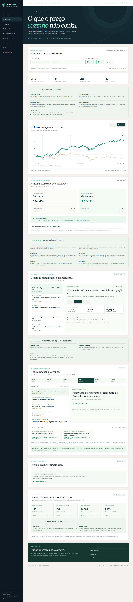

# Market Lens BR

**Financial data research: price returns, coupon-adjusted returns and model transparency.**

[Public demo — Portuguese](https://market-lens-br-web.onrender.com/) · [Case study](docs/CASE_STUDY.md) · [Português](README.pt-BR.md) · [Portfolio](https://guilherme-molina-portfolio.guilhermemolinasolan.chatgpt.site/)



## Research question

How does the interpretation of a Brazilian government bond change when coupon payments are incorporated into its returns?

The public demo compares price-only and coupon-adjusted return regressions using the **same dates and factors**. It exposes coefficients, 95% confidence intervals, R² and chronological out-of-sample error. A separate local workflow supports equity CSVs with dividends, interest on equity and stock splits.

## What this demonstrates

- Public-source ingestion, normalization, provenance and reproducible SQLite snapshots.
- Python return calculations and OLS modeling with explicit time alignment.
- Chronological training/holdout separation; missing factors remove the same interval from both comparisons.
- A React/TypeScript research interface with metric explanations.
- Clear boundaries between event timing, statistical association and causality.

Sources include Brazil's Treasury, central bank, EIA, World Bank and CVM. Monthly commodity series remain separate from daily regressions. News coverage provides context; detection time is not treated as verified publication time.

## Read the results responsibly

Coupon-adjusted gross return is a one-period approximation. It does not reinvest coupons or include taxes, custody fees, spreads, liquidity, inflation or final redemption value. Temporal holdout validation does not make the model a trading simulation: source availability and descriptive use of market factors still matter.

Post-disclosure movements are temporal associations, not causal estimates. This is exploratory historical research, not investment advice. Public snapshots do not redistribute equity prices; equity analysis is local only.

[Methodology, Portuguese](docs/METODOLOGIA.md) · [Sources and licenses, Portuguese](docs/FONTES.md) · [Architecture, Portuguese](docs/ARQUITETURA.md)

## Run locally

Requires Python 3.12+ and Node.js 20+.

```bash
python -m venv .venv
# Windows: .venv\Scripts\activate
# macOS/Linux: source .venv/bin/activate
pip install -e "backend[dev]"
cd backend
python -m app.data.demo
python -m app.data.demo --database data/company_news.db --archive demo/company_news_snapshot.sqlite.gz
uvicorn app.main:app --reload
```

In another terminal, from the repository root:

```bash
cd frontend
npm ci
npm run dev
```

Open http://localhost:5173. Vite forwards `/api` to the local backend. The API documentation is served at `/docs` on the backend.

## Verify

```bash
cd backend
python -m pytest -q
cd ../frontend
npm run build
```

| Area | Evidence |
| --- | --- |
| Aligned returns and coupon allocation | [returns.py](backend/app/analysis/returns.py) |
| Same-sample regressions and holdout | [regression.py](backend/app/analysis/regression.py) |
| Regression and return checks | [test_returns_regression.py](backend/tests/test_returns_regression.py) |
| Demo sources and immutable inputs | `backend/demo/` and [source documentation](docs/FONTES.md) |

The [Portuguese operations guide](README.pt-BR.md) preserves complete commands for refreshing data, local equity/news imports and deployment. `render.yaml` defines the hosted demo. Its free API may take about a minute to wake after inactivity. The application uses frozen public snapshots rather than a guaranteed live market feed.

Code follows [LICENSE](LICENSE); data sources have their own terms documented in [FONTES.md](docs/FONTES.md).
