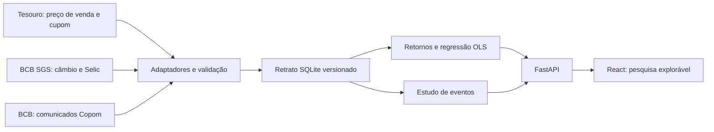

# Arquitetura

## Fluxo atual

O comando `python -m app.data.refresh` obtém fontes abertas e cria um arquivo SQLite temporário. A versão anterior continua utilizável se houver falha de download, normalização ou gravação. Após validação, uma substituição atômica ativa o novo retrato. Cada observação retém data, fonte, horário de coleta e versão de normalização. A API lê o mesmo retrato em todos os endpoints.

O arquivo compactado em `backend/demo/` fixa uma versão verificável para o portfólio. O servidor descompacta esse arquivo quando não existe banco local. Atualizações são uma operação separada, evitando que o visitante dependa da disponibilidade das fontes no momento da navegação.

## Cálculos e contratos

`build_return_frame` alinha cotações do mesmo título e vencimento às variáveis diárias. Ele inclui no intervalo todos os cupons cujo pagamento ocorreu depois da cotação anterior e até a atual. `compare_regressions` ajusta duas OLS sobre a mesma matriz de fatores e separa cronologicamente treino e teste. `study_event` desloca comunicados sem horário conhecido para o pregão seguinte e calcula o retorno observado menos o retorno de um título de referência.

| Endpoint | Resultado |
| --- | --- |
| `GET /api/catalog` | Títulos, fatores, cobertura, fontes e versão. |
| `GET /api/series/{id}` | Observações e pagamentos com links de origem. |
| `GET /api/research/regression` | Retornos alinhados, dois modelos e métricas. |
| `GET /api/events` | Comunicados, janelas de 1/3/5 pregões e coorte. |

Erros de falta de dados têm um `reason` estável e uma mensagem em português. O frontend não recebe chaves privadas.

## Expansão

A pesquisa local de ações ficará em um banco separado do retrato público, com preços, desdobramentos, dividendos e JCP importados pelo pesquisador. Documentos da CVM e metadados de notícias terão identificação, fonte e regra temporal antes de entrar em estudos de eventos. Commodities e variáveis mensais terão frequência e disponibilidade documentadas; não serão misturadas ao modelo diário sem uma regra de divulgação verificável. Serviços de IA podem ajudar a etiquetar documentos, mas os números de mercado continuarão calculados por funções auditáveis.
