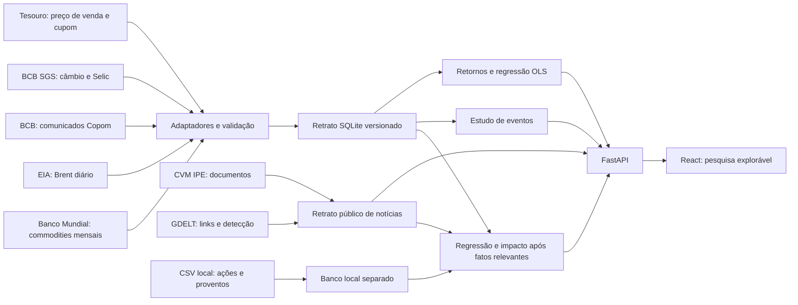

# Arquitetura

## Fluxo atual

Os comandos `python -m app.data.refresh` e `python -m app.data.news_store` obtêm fontes abertas e criam arquivos SQLite temporários. As versões anteriores continuam utilizáveis se houver falha de download, normalização ou gravação. Após validação, uma substituição atômica ativa cada retrato. Cada observação retém data, fonte, horário de coleta e versão de normalização. A API lê os retratos versionados por endpoint.

Os arquivos compactados em `backend/demo/` fixam versões verificáveis para o portfólio. O servidor os descompacta quando não existem bancos locais. Atualizações são uma operação separada, evitando que o visitante dependa da disponibilidade das fontes no momento da navegação. A base local de ações não é empacotada.

## Cálculos e contratos

`build_return_frame` alinha cotações do mesmo título e vencimento às variáveis diárias. Ele inclui no intervalo todos os cupons cujo pagamento ocorreu depois da cotação anterior e até a atual. `compare_regressions` ajusta duas OLS sobre a mesma matriz de fatores e separa cronologicamente treino e teste. `study_event` desloca comunicados sem horário conhecido para o pregão seguinte e calcula o retorno observado menos o retorno de um título de referência.

Para ações importadas, `build_return_frame` também neutraliza desdobramentos e incorpora dividendos e JCP. `study_filing_impact` ajusta o referencial com até 60 sessões anteriores ao fato relevante da CVM e calcula diferenças posteriores de 1, 3 e 5 sessões. Fatores mensais são identificados no catálogo e rejeitados na regressão diária. O GDELT fornece contexto de cobertura, sem ser usado como relógio de publicação ou como variável de impacto.

| Endpoint | Resultado |
| --- | --- |
| `GET /api/catalog` | Títulos, fatores, cobertura, fontes e versão. |
| `GET /api/series/{id}` | Observações e pagamentos com links de origem. |
| `GET /api/research/regression` | Retornos alinhados, dois modelos e métricas. |
| `GET /api/events` | Comunicados, janelas de 1/3/5 pregões e coorte. |
| `GET /api/company/news` | Documentos CVM e links de cobertura por companhia. |
| `POST /api/local/equity/import` | Importação CSV, habilitada apenas em ambiente local. |
| `GET /api/local/equity/{ticker}/regression` | Dois retornos de ação, mesma amostra e fatores. |
| `GET /api/local/equity/{ticker}/news-impact` | Fatos relevantes ligados a retorno posterior e referencial pré-evento. |

Erros de falta de dados têm um `reason` estável e uma mensagem em português. O frontend não recebe chaves privadas.

## Próximos refinamentos

Uma futura etapa pode adicionar um conjunto de preços de ações com licença pública de redistribuição, cobertura jornalística mais ampla e histórico de revisões das notícias. Modelos mensais exigirão uma regra verificável de data de publicação. Serviços de IA podem ajudar a etiquetar documentos, mantendo os números de mercado calculados por funções auditáveis.
